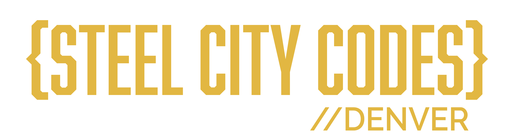

<p align="center">
  
</p>

<h1 align="center">Steel City Codes Management System</h1>

<p align="center">
  Registration and camp-operations platform for the Denver chapter of
  <a href="https://steelcitycodes.org">Steel City Codes</a>, a summer coding camp for kids.
</p>

<p align="center">
  <a href="https://scc.haanie.com"><strong>Live demo</strong></a> ·
  <a href="docs/database.md">Database setup</a> ·
  <a href="docs/testing.md">Testing</a> ·
  <a href="docs/specs/README.md">Roadmap</a> ·
  <a href="CONTRIBUTING.md">Contributing</a>
</p>

<p align="center">
  <a href="https://github.com/DenverSteelCityCodes/Denver-Steel-City-Codes-Management-System/actions/workflows/ci.yml"></a>
  <a href="LICENSE"></a>
</p>

---

Families register campers for week-long classes, volunteers apply and get crewed onto sections, and admins run the whole season, from opening registration to taking roll calls during camp week. It replaces a spreadsheet-and-email process, and it's being readied for the February 2027 registration opening.

## Try the demo

**[scc.haanie.com](https://scc.haanie.com)** has one-click logins for an admin, a parent, a volunteer and an applicant. Everything in it is fictional and resets every night, so click anything.

## What it does

**Parents**
- Register campers through a five-step wizard that saves a draft, with an automatic waitlist when a class is full
- Browse classes by week and age, and see each camper's status per year
- Cancel or switch class themselves until the change deadline, then send a change request
- Claim a waitlist offer within its window (48 hours, 12 in the final week)

**Volunteers**
- Apply, then book their own interview slot
- See their section, crew, roster and daily duties
- Take named roll calls (arrival, after lunch, dismissal) and post updates
- Set week and course preferences, request a switch, or report an absence

**Admins**
- Manage sessions, courses, sections, capacity and crews, with a volunteer-matching helper that pairs new and experienced volunteers
- Review applications and interviews, and accept volunteers onto crews
- A "Needs attention" queue, search, a live attendance board, printable rosters and CSV exports
- Edit registration forms, and set the season's opening time and deadlines
- See every change in the audit history and undo one with a click
- Sign in with a second factor (TOTP)

## How it's built

| Layer | |
|---|---|
| Frontend | React 19, TypeScript, Vite, Tailwind CSS v4, React Router 7 |
| Backend | Supabase: Postgres, Auth, Row Level Security, `pg_cron`, one Edge Function |
| Email | A database outbox drained every minute by `supabase/functions/send-notifications` (Resend) |
| Tests and CI | Vitest unit tests, SQL/RLS suites, a concurrency test; GitHub Actions on every PR |
| Hosting | Vercel (static SPA) |

There is no app server. The browser talks to Supabase directly, so **the database is the security boundary**: RLS policies, triggers and `SECURITY DEFINER` functions enforce roles, capacity, age ranges, one class per camper per week, waitlist order and change deadlines. Volunteers read camper data only through `section_roster()`, which returns just their own section's roster fields. Each migration's header explains the rule it adds.

```
src/
  pages/        one component per route (Admin*, Parent*, Volunteer*, auth pages)
  components/   shared UI (layouts, roll call, updates feed, inline confirm, ...)
  hooks/        data access: one hook per table or view, all through supabase-js
  lib/          pure helpers (Denver time, CSV export, matcher, drafts), unit tested
  types/        database.ts, the typed schema the app queries against
migration_*.sql database changes, applied in the order in docs/database.md
supabase/       Edge Function for outgoing email
test-plans/     SQL/RLS test suites and the seat-race script
docs/           improvement plan, per-feature specs, runbooks, testing guide
design/         design handoffs; tokens are in design_system.md
```

## Run it locally

You need Node 22+ and a Supabase project of your own.

```bash
git clone https://github.com/DenverSteelCityCodes/Denver-Steel-City-Codes-Management-System.git
cd Denver-Steel-City-Codes-Management-System
npm install
cp .env.example .env.local   # then fill in your project's URL and anon key
npm run dev                  # http://localhost:5173
```

Then set up the database by following **[docs/database.md](docs/database.md)**: apply the SQL files in order and promote your first admin.

| Variable | Where | |
|---|---|---|
| `VITE_SUPABASE_URL` | `.env.local` | Your project URL |
| `VITE_SUPABASE_ANON_KEY` | `.env.local` | The public anon (publishable) key. Never put a service-role key here: everything prefixed `VITE_` ships to the browser |
| `VITE_DEMO_*` | `.env.demo.local` | Optional demo logins, only with `--mode demo` on a demo database |
| `RESEND_API_KEY`, `NOTIFY_FROM`, `NOTIFY_REPLY_TO`, `APP_URL` | Supabase Edge Function secrets | Outgoing email (optional) |

### Scripts

| Command | |
|---|---|
| `npm run dev` | Dev server with hot reload |
| `npm run lint` | ESLint |
| `npm test` | Vitest unit tests |
| `npm run build` | Type-check and production build to `dist/` |
| `npm run build:demo` | Same, with the demo login buttons |

## Documentation

| | |
|---|---|
| [docs/database.md](docs/database.md) | Setting up a Supabase project from scratch, the demo environment |
| [docs/testing.md](docs/testing.md) | Unit, SQL/RLS and concurrency tests |
| [docs/scc-improvement-plan.md](docs/scc-improvement-plan.md) | The plan to February 2027: risks, legal items, build order, decisions |
| [docs/specs/](docs/specs/README.md) | One spec per feature or PR, with status and issue links |
| [docs/runbooks/security-incident.md](docs/runbooks/security-incident.md) | What to do if data may have been exposed |
| [design_system.md](design_system.md), [design/](design/README.md) | Brand tokens and design handoffs |
| [CLAUDE.md](CLAUDE.md) | House workflow (also read by Claude Code, which helped build this) |
| [PLAN.md](PLAN.md) | The original June 2026 plan, kept for history |

## Contributing

Issues and pull requests are welcome. Start with [CONTRIBUTING.md](CONTRIBUTING.md): one issue → one branch → one PR, with lint, tests and build passing. Please follow the [Code of Conduct](CODE_OF_CONDUCT.md).

## Security

Please don't open a public issue for a vulnerability. See [SECURITY.md](SECURITY.md) for how to report one privately.

## License

The code is released under the [MIT License](LICENSE). © 2026 Haanie Mohammed.

The Steel City Codes name and logo belong to Steel City Codes and aren't covered by the license. If you run your own copy, please use your own name and branding.
