# SCC Management Platform: Improvement Plan

**Prepared:** 2026-10-16 · **For:** Regional Director, SCC Denver · **Status:** draft for office hours. Nothing gets built until you approve this.
**Codebase read:** `origin/main` @ `6ae38ff` (everything merged as of today). **No application code was changed.**

**Legend.** ✅ verified (read in code or measured) · 🔎 inferred (reasoned from code or docs, not observed) · ❓ unsure (on the office-hours agenda) · **P0** must ship before registration opens in Feb 2027 · **P1** should · **P2** later · **S/M/L** effort ≈ ½–1 day / 2–4 days / 1–2 weeks of focused work.

---

## 0. One-page summary

**Where things stand.** The app does a lot already. Parents register campers through a 5-step wizard, with waitlisting when a class is full. Volunteers apply, book an interview, get accepted and are crewed onto sections. Admins run classes, sessions, duties, interviews, roll calls, updates and exports. The database enforces the hard rules: capacity, age range, one class per week, and roles. Two things are missing. One is everything *after* the first sign-up: changing your mind, the waitlist moving, and anyone being told anything by email. The other is everything needed to run it at more than one chapter.

### Top 5 risks (what hurts us in February if we do nothing)

| # | Risk | Why it matters | Fix (PR #) |
|---|---|---|---|
| 1 | **Sign-up emails stop after 2 an hour.** New accounts must confirm by email, and Supabase's built-in sender is capped at 2 emails/hour ([Supabase docs](https://supabase.com/docs/guides/auth/auth-smtp)). | On opening night almost every new parent waits for a confirmation link that never arrives. This is the first thing to break, and it has nothing to do with load. | Custom SMTP (PR 2), **S** |
| 2 | **There is no production database.** The only project (`rdckxazvoeixgwtjhrlf`) is the public demo, and a nightly job **deletes every non-demo account**. | Real families registered there would be wiped at 3 am. | Separate prod project (PR 1), **S** |
| 3 | **No password reset.** ✅ There's no "Forgot password" anywhere (`resetPasswordForEmail` is never called). | Returning families from 2026 who forgot their password are locked out and email you instead. | PR 3, **S** |
| 4 | **Volunteer access to camper data is broader than the roster needs.** ✅ Found 2026-10-16 (details are kept off this public repo until spec 04 merges). Many volunteers are teenagers (the apply form accepts 14+). | A minor-privacy risk to close before any real family registers. Only fictional demo data is involved today. | PR 4, **S** |
| 5 | **Changes are silent and irreversible.** No audit log. Deleting a section hard-deletes its registrations. Waitlist promotion is manual, with no email. Parents can't drop or swap without contacting you. | You can't answer "who changed this?" or undo a mistake. Every change becomes an email to you. | PRs 5–6, 10–12, 15 |

### Top 5 wins (highest value per hour)

1. **Custom email + password reset** (PRs 2–3). Two small PRs remove the most likely opening-night failure.
2. **Waitlist that runs itself** (PR 10). When a seat opens, the next family gets a 48-hour offer by email. Everyone comparable has some version of this (§3).
3. **Parent self-service cancel and swap before a deadline** (PRs 11–13). This removes the biggest category of admin email.
4. **Audit log + undo** (PRs 5, 15). One generic database trigger makes every change traceable and the admin override safe.
5. **Auto-confirm + "section has no lead" alert** (PR 14). Today each "Spot held" registration is confirmed one at a time ✅. Decided 2026-10-16: the confirm step checks nothing, so seats are confirmed the moment they're held. That removes hours of clicking and a confusing status.

### Legal must-dos before February (detail in §4; none of this is legal advice)

1. **Have counsel review the waiver.** Colorado lets a parent waive a child's future negligence claims only if the decision is "voluntary and informed" ([C.R.S. 13-22-107](https://colorado.public.law/statutes/crs_13-22-107)). Today's waiver is hardcoded app text, mentions "refund", bundles five consents, and we don't store which version anyone signed ✅.
2. **Confirm we don't need a child-care license.** Colorado exempts single-skill classes, but the exemption ends when "activities other than the identified single skill" are provided ([CDEC](https://cdec.colorado.gov/for-providers/legal-exemption-from-child-care-licensing)). Our schedule has lunch, breaks and "candy consent" ✅. This is a question for counsel, not for code.
3. **Publish a privacy notice and run a short data protection assessment.** Colorado's 2025 minors' amendment has no size threshold, and we knowingly serve minors: volunteers aged 14–17 hold their own accounts ✅ ([Lowenstein summary](https://www.lowenstein.com/news-insights/publications/client-alerts/colorado-tightens-rules-on-minors-online-data-are-you-ready-for-october-1-data-privacy)).
4. **Unbundle photo consent** (opt-in, default off, visible on rosters), and record each signature with the waiver version it was for (PR L2).
5. **Write a disposal policy and a breach plan.** Colorado gives 30 days to notify residents after a breach, plus the Attorney General at 500+ ([Mintz](https://www.mintz.com/mintz-matrix/colorado)).

### Build order at a glance (detail in §5)

```
Oct–Nov  Foundations   1 prod project · 2 SMTP · 3 password reset · 4 volunteer PII lockdown
                       5 audit log · 6 soft-cancel · 7 edit conflicts · 8 tests + CI
Dec–Jan  Feb-critical  9 email outbox · 10 waitlist offers · 11 cancel · 12 swap · 13 deadlines
                       14 auto-confirm + no-lead alert · 15 history/undo UI · 16 wizard drafts
                       17 fewer round trips · 18 admin pagination · 19 load test + runbook + dry run
Oct–Jan  Legal track   L1 privacy notice + terms · L2 waiver/consent records · L3 photo flag on roster
         (alongside)   L4 disposal policy + retention job · L5 breach runbook · counsel + licensing check
Feb 2027 Registration opens (Denver pilot)
Mar–Jun  Handoff       20 chapters · 21 national view · 22 N-week seasons · 23 per-chapter forms
                       24 second guardian · 25 volunteer self-service · 26 docs + admin guide
                       L6 accessibility audit · L7 volunteer clearance tracking · per-state legal checklist
```

### Context fields you left blank (my best reading, please correct)

| Field | What I found or assumed |
|---|---|
| Repo / stack / hosting | ✅ `DenverSteelCityCodes/Denver-Steel-City-Codes-Management-System`. React 19 + Vite + TypeScript + Tailwind v4 SPA. Supabase (Postgres + Auth + RLS) with **no server code of its own**: every rule is a Postgres trigger, policy or RPC. Hosted on Vercel (`scc.haanie.com`), deployed by hand with the CLI. Supabase **Pro** (you, today). |
| Peak users | ❓ Not in the code. The demo seed has 73 campers, 9 sections and 28 volunteer applications. **I planned for** 300–600 parents, 400–800 campers, 40–80 volunteers, 3–6 admins and 15–30 sections, with most parents arriving in the first 15 minutes. |
| What works today | ✅ See "Where things stand" above, and the flow maps in §1. |
| Known pain points | ✅ From the QA and audit docs: the 2026 issues are fixed (security holes, waitlist counts, date bugs). Deliberately left to phone or text: late arrivals, authorized pickup, incidents, volunteer sick days (`test-plans/camp-week-gap-audit-2026-09-30.md`). ❓ I have no parent or volunteer complaints. Please bring any. |

---

## 1. Domain 1: Design (UX + flow mapping)

**Summary.** I mapped 19 flows: 8 for parents, 6 for volunteers, 4 for admins, 1 national. Eleven work end to end today. Four exist only off-app or not at all: parent cancel/swap, waitlist notification, password reset, and the national view. The friction is mostly **dead ends**: there's no way to undo, change or be told anything, so a parent's only option is to email you. The UI itself is in good shape. The QA rounds checked 375 px layouts, labelled inputs and dark mode, and the style guide (cream/gold, Josefin, role colors) is applied consistently. Every proposal below stays inside the v1.0 style guide and your "no modals, inline confirm" rule.

**Cross-cutting UX findings**

| Principle | Finding | Fix |
|---|---|---|
| Clear feedback | ✅ The app sends no email at all. "Also email" opens the admin's own mail client. Status changes (confirmed, promoted, moved, cancelled) show up only when the parent next opens the dashboard. | Transactional email (PR 9) for every status change that matters to a parent. |
| Fewest steps | ✅ A new family goes signup → confirm email → login → dashboard → "Add camper" → 5 wizard steps. That's 9 screens and 2 apps before they hold a seat. | Land on the wizard right after first login when the family has no campers. Keep the wizard to 5 steps but save drafts (PR 16). |
| Mobile-first | ✅ Layout is verified at 375 px. 🔎 The wizard keeps all progress in memory: the phone back button, a reload or an app switch that kills the tab loses every step. | Step in the URL plus a local draft (PR 16). |
| Recover from mistakes | ✅ Parents can't cancel or swap. Admins can, but deletes are permanent. | PRs 6, 11, 12, 15. |
| Accessibility | ✅ Labels are linked to inputs and alerts use `role="alert"`. 🔎 Wizard errors appear at the bottom and aren't focused, so screen-reader users may miss them. Step dots have no text equivalent. | Move focus to the error. Add "Step 2 of 5" text (part of PR 16). |
| Status language | ✅ "Spot held · We'll confirm soon" is warm, but the confirm step checks nothing (decided 2026-10-16), so it's noise. | Office hours: decide whether `pending` should exist at all (Q-P4). |

### 1.1 Parent flows

#### P1. Account creation and login ✅

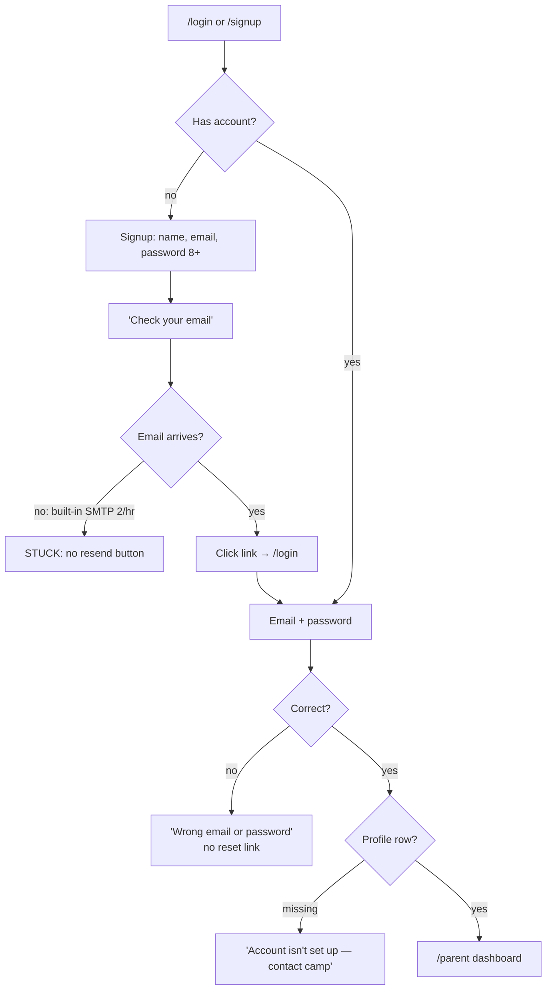

| Friction | Severity | Fix |
|---|---|---|
| Confirmation email throttled, and no "resend" | 🔴 | PR 2 (SMTP) + resend link on the "Check your email" screen (PR 3) |
| No forgot-password | 🔴 | PR 3 |
| Same email used for the volunteer apply form → "already registered" with no path forward ❓ | 🟠 | Explain and link to sign-in (PR 3) |
| Duplicate accounts: nothing stops two guardians making two accounts and two copies of the same kid | 🟠 | Household invites (PR 24); duplicate detection (PR 14b) |

#### P2. Register a new camper (wizard) ✅

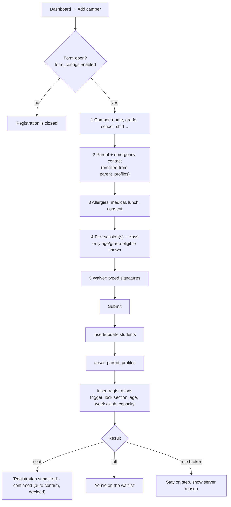

| Friction | Severity | Fix |
|---|---|---|
| Progress lives in memory; back, reload or a killed tab loses it | 🔴 on phones | PR 16 |
| Fill counts are loaded once. A seat shown as open can be gone by step 5, which surprises the parent with a waitlist | 🟠 | Re-check fill on entering step 4 and before submit; say "1 spot left" honestly (PR 16) |
| Submit is four separate writes with no transaction. A failure after the camper is saved leaves "camper with no class" (handled with a retry, but fragile) | 🟡 | One `register_camper()` RPC in a transaction (PR 17) |
| Waiver text is hardcoded in the page, says "Denver Summer Camp", bundles photo release with the liability waiver, and records no version | 🔴 legal | Counsel-reviewed, versioned waiver with separate consents and an emailed copy (PR L2, §4) |
| Age is derived from grade (`4th→9 … 9th→14`); no date of birth | 🟡 | ❓ Q-P2: is grade the official eligibility rule? |

#### P3. Register an existing camper (class browser + yearly re-confirm) ✅

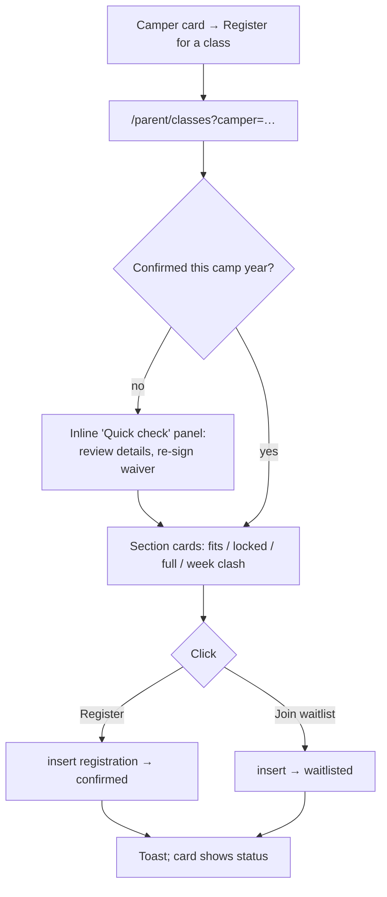

| Friction | Fix |
|---|---|
| Two ways to register (wizard vs. browser) with different steps. ❓ Parents may not know which to use | Office hours Q-P1: keep both, or make the browser the only path for returning campers |
| The toast is the only confirmation; no email | PR 9 |

#### P4. Edit camper and contact info ✅

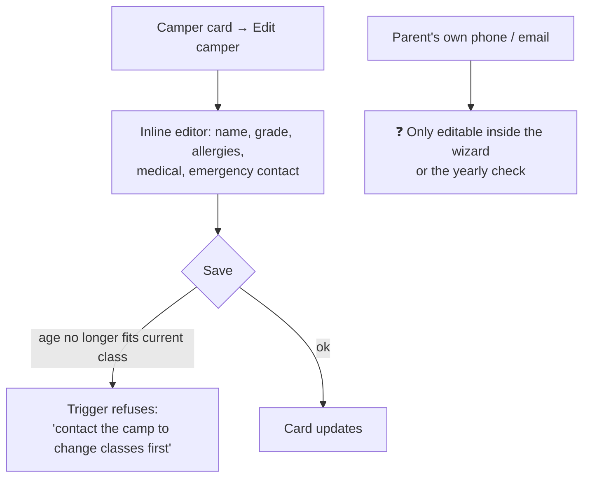

| Friction | Fix |
|---|---|
| No "My details" page for the parent's own contact info | Small inline "Your contact details" card on the dashboard (PR 11, same screen) |
| Last write wins: admin and parent editing the same camper overwrite each other silently | PR 7 |
| No record of what changed (allergies matter) | PR 5. Also notify the section lead when allergies or medical change during camp week (PR 9) |

#### P5. Cancel / drop / swap ❌ not built (parents)

✅ Today: parents have **no update or delete on registrations** (`migration_security_hardening.sql §4`). The dashboard offers no cancel action. The camp's official address, `denver@steelcitycodes.org`, appears only on the volunteer apply page, so parents have no in-app way to reach you. Quick fix (fold into PR 11): show it in the parent footer and on every "contact the camp" message.

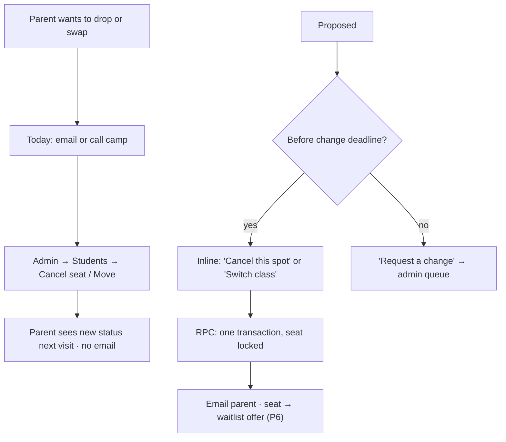

Rules proposed in §2.1. Friction today: 🔴 every change is admin labour, and parents who quietly stop coming leave a held seat nobody else can use.

#### P6. Waitlist ✅ (manual) → proposed automatic

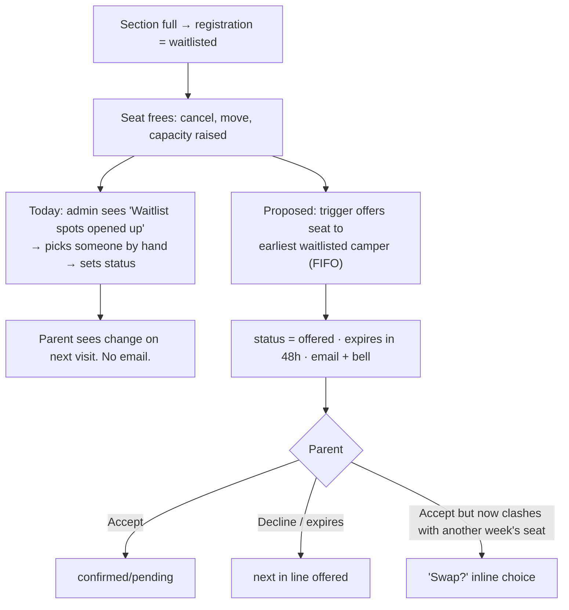

| Friction today | Fix |
|---|---|
| Nobody is told a seat opened, so it can sit empty | PR 10 |
| Admin chooses who gets it, which isn't visibly fair | ✅ Decided order: campers displaced by a cancelled section → campers with no seat that week (FIFO) → seat-holders skipped. Admin can override, logged |
| A parent can hold a waitlist spot in class B while holding a seat in class A that same week (allowed on purpose). On promotion they'd hold two seats | ✅ Decided: same-week backups are **blocked** (Q-W4), and taking a seat withdraws that week's other waitlist entries (PR 10) |

#### P7. Notifications ✅ (in-app only)

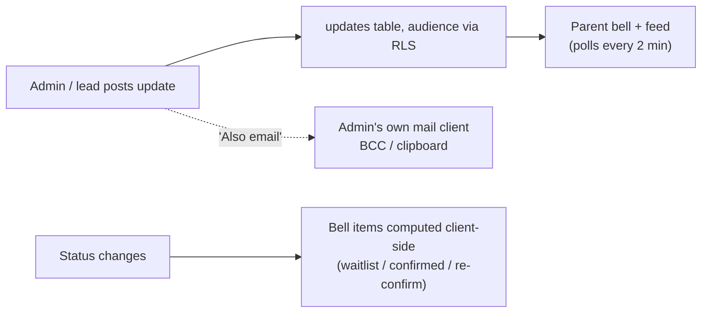

| Friction | Fix |
|---|---|
| Nothing reaches a parent who doesn't open the app | PR 9 (email outbox). SMS is P2 |
| "Also email" depends on one admin's inbox; nothing records whether it went out | Send through the outbox and record it (PR 9) |
| The bell's "seen" state is per device (localStorage) | 🟡 P2 |

#### P8. Camp week (parent) ✅
"This week" card: class · time · room · lead's first name · today's roll-call status. Works. Friction: 🟡 no "my camper will be late or absent" path (deliberately left to phone; keep it that way).

### 1.2 Volunteer flows

#### V1. Apply + book interview ✅

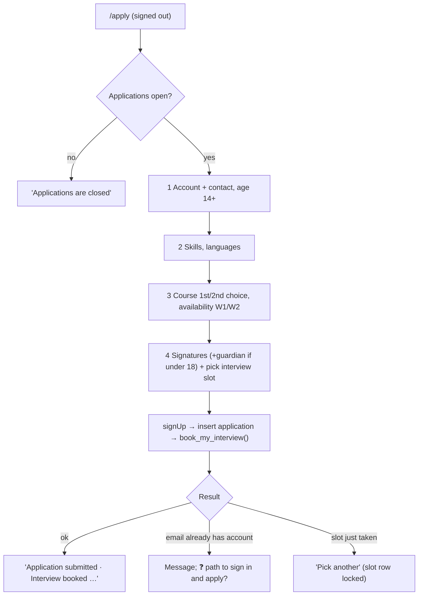

Friction: 🟠 the same 2/hour email cap hits applicants. 🟡 availability is hardwired to "Week 1 / Week 2".

#### V2. Applicant waiting room ✅
Dashboard shows "under review", interview time with reschedule, or "not accepted". Friction: 🟡 no email on accept or reject (PR 9).

#### V3. Assignment to a class ⚠️ admin-only

✅ Your brief says volunteers "pick/change the classes they'll teach". **Today they don't.** They state first and second course choices on the application, then an admin crews them (by hand or with the auto-matcher, which pairs one senior with one junior per section). After acceptance a volunteer can't edit availability or preferences: the self-update policy was removed on purpose, so volunteers can't upgrade their own experience level.

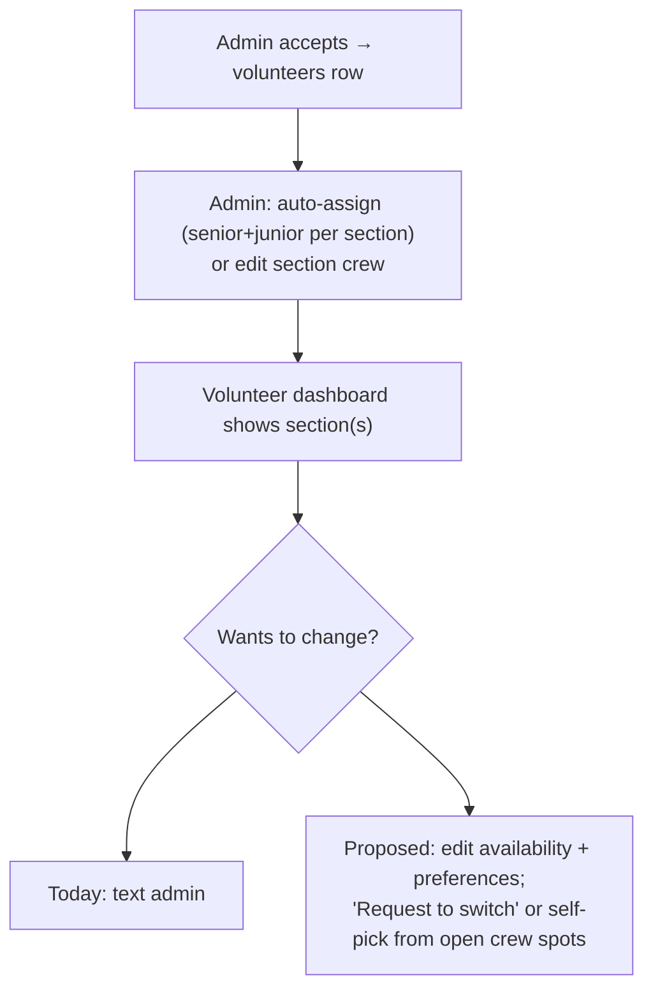

✅ **Decided 2026-10-16 (Q-V1): preferences + admin assigns.** Volunteers can edit their availability and course preferences and request a switch; admins (with the auto-matcher) still assign, so the senior/junior pairing holds. No self-pick. It's P1 either way.

#### V4. Duty slots ✅
Claim/unclaim with capacity enforced by a locked trigger. Friction: 🟡 no reminders, no swap.

#### V5. Camp day (lead/support) ✅
Roster with allergies and emergency tel: links, three roll calls, lead posts section updates, printable roster. Works.

#### V6. Volunteer drops (incl. last-minute) ⚠️ off-app → cross-role

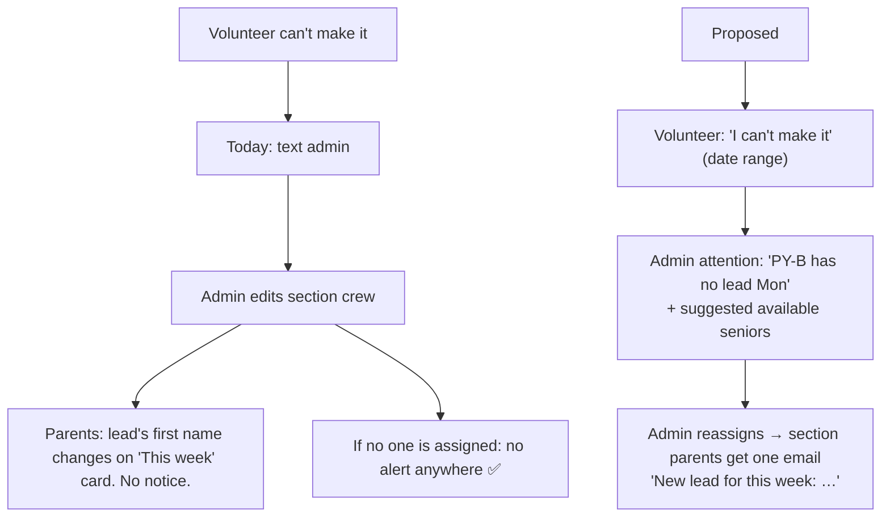

### 1.3 Admin flows

#### A1. Season setup ✅
Sessions (dates, active) → classes → sections (ages, capacity, week, days/time/room, lead, supports) → daily schedule → open forms. Friction: 🟠 "open registration" is a manual switch, so nothing opens at a set time (PR 13). 🟡 Sessions map to "Week 1/2" by date order, a hard 2-week model (PR 22).

#### A2. Volunteer pipeline ✅
Review application → interview (slots, notes) → accept as junior/senior (sets role + volunteers row) or reject → crew. Friction: 🟡 no background-check field ❓ Q-V3.

#### A3. Registration management ✅

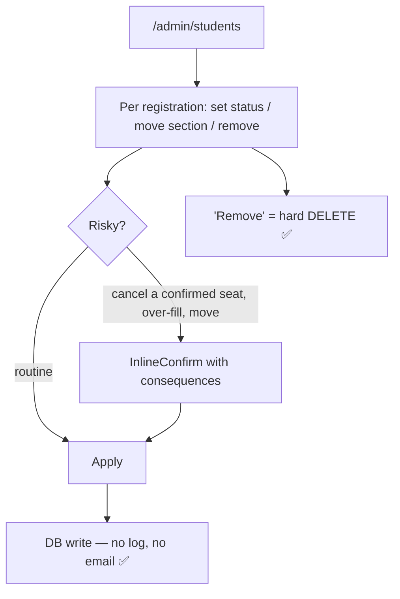

Friction: 🔴 every seat waits for a manual confirm (fixed by auto-confirm, PR 14). 🔴 no log. 🟠 "Remove" deletes history. 🟠 moves skip the insert trigger's checks (warned in UI, but not enforced or logged).

#### A4. Cancel or delete a class/section with people in it ✅ cross-role

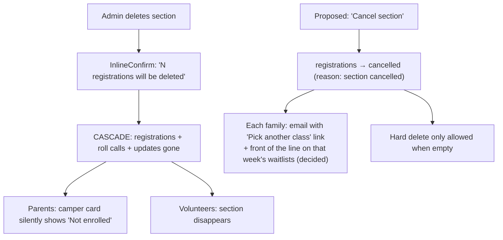

#### A5. Users and roles ✅
Change role (last-admin guard on the server; a volunteer leaving crew is cleaned up). Friction: 🟠 one admin level, with no chapter scoping (PR 20). 🟠 no MFA for admins (P1).

#### A6. Communications ✅ (see P7). A7. Camp-day ops ✅: live "unaccounted" board, CSV export.

### 1.4 National-team admin view (N1) ❌ does not exist

✅ There is no chapter concept anywhere in the schema. One admin role sees everything. Proposed (P1 for handoff, not for the Feb pilot):

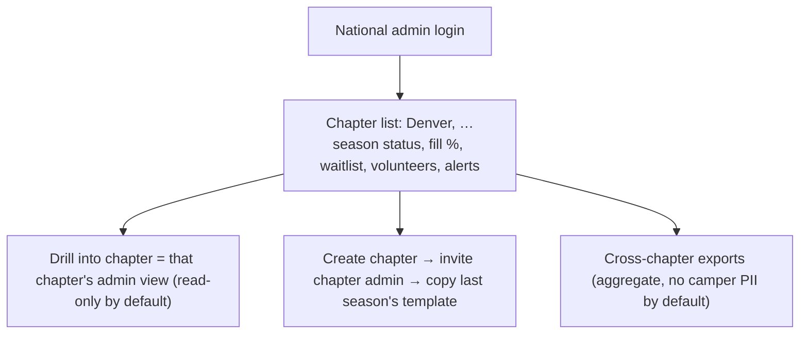

### 1.5 Where flows cross roles

| Trigger | Parent sees | Volunteer sees | Admin sees | Today ✅ / proposed |
|---|---|---|---|---|
| Parent registers | "Spot held" | Camper appears on roster (even while pending) | Count rises | ✅ / + confirmation email |
| Seat opens | — | — | "Waitlist spots opened up" | ✅ manual / auto-offer + email |
| Admin moves camper | Card changes next visit | Roster changes | — | ✅ silent / email parent + log |
| Volunteer drops | Lead name changes | — | **nothing** | ✅ silent / attention item + one email |
| Admin cancels section | "Not enrolled" | Section gone | — | ✅ hard delete / soft cancel + email + rebook link |
| Camper allergy edited mid-week | — | Roster shows new text on refresh | — | ✅ silent / notify lead |
| Lead posts update | Bell + feed | — | Listed | ✅ |

---

## 2. Domain 2: Engineering

**Summary.** The database layer is the strongest part. Capacity, age, one-class-per-week, roles, duty capacity and interview booking are all enforced server-side with row locks. The gaps are traceability (no audit), lifecycle (no soft-cancel, waitlist or deadlines), one privacy gap (volunteer access to camper data, PR 4), and operations (no prod project, no tests in CI, manual migrations and deploys). Performance is fine for today's data. Pages feel slow because of request fan-out, not slow queries.

### 2.1 Self-service editing with admin override

**Findings ✅.** Parents can edit camper details (with an age guard) but can't change registrations. Volunteers can edit nothing about themselves except duty claims and roll calls. Admins can edit everything directly through table writes, with no record.

**Proposed rules (❓ confirm in office hours, defaults shown)**

| Who | Can change | Until | After the deadline | Notifies |
|---|---|---|---|---|
| Parent | Camper details, own contact | Any time (age guard stays) | Same | Lead, if medical/allergy changes during camp week |
| Parent | Cancel a seat | **14 days before session start** ✅ decided | "Request a change" → admin | Parent (receipt); seat → waitlist offer |
| Parent | Swap class (same week) | 14 days before ✅ decided | Request → admin | Parent; old seat → waitlist offer |
| Parent | Accept/decline a waitlist offer | 48 h after offer (12 h inside 7 days of start) ✅ decided; FIFO | Offer passes on | Parent; next in line |
| Volunteer | Availability, course preferences | Until crewed for that week | Request a switch | Admin |
| Volunteer | "Can't make it" | Any time | — | Admin (attention item) |
| Admin | Anything | Any time | Any time | Whoever's affected, by default; "don't notify" checkbox for silent fixes |

**How it's enforced**
- **One RPC per action** (`cancel_my_registration`, `swap_my_registration`, `accept_offer`, …): SECURITY DEFINER, deadline checked against `seasons.change_deadline_days`, runs in one transaction under the section row lock. Parents still have no direct UPDATE or DELETE.
- **Audit log (PR 5).** One generic trigger writes `audit_log(at, actor_id, actor_role, table_name, row_id, action, old jsonb, new jsonb, reason)` on `students, registrations, sections, section_supports, volunteers, parent_profiles, profiles(role), form_configs, app_settings, sessions`. Readable by admins only. The RPCs set `reason` (e.g. `'parent_cancel'`, `'waitlist_offer_expired'`).
- **Undo (PR 15).** A "History" strip on each camper and section, plus "Revert" on any single change. Revert re-applies `old` as a new, logged change; nothing is erased. Reverting a delete is possible only because of soft-cancel (PR 6).
- **Admin override stays.** Admin writes skip the rules (as today) but always land in the log with the admin's id.

### 2.2 Resilience and edge cases

| Edge case | Expected behavior | Enforced by | Today |
|---|---|---|---|
| **Two people grab the last seat** | Exactly one gets `pending`. The other is told in-flow "That class just filled, you're #1 on the waitlist" | DB: `registrations_before_insert` takes `SELECT … FOR UPDATE` on the section row, counts seats, sets status. A per-camper advisory lock stops two parallel sign-ups for different sections in the same week | ✅ built. PR 8 adds a concurrency test (N parallel inserts → capacity never exceeded). UI copy PR 16 |
| **Full → waitlist → seat opens** | Offer order (decided): (1) campers displaced by a cancelled section, (2) campers with **no seat that week**, by join time; campers already holding a seat that week are skipped. The chosen camper gets `offered` for 48 h (12 h in the final week); email + bell. Accept → seat. Decline/expire → next. Admin can reorder or override (logged) | DB: `AFTER UPDATE/DELETE` trigger on registrations + capacity changes calls `offer_next_seat(section)`; pg_cron sweeps expired offers every 10 min; the offer holds the seat (counts toward capacity) | ❌ manual (PR 10) |
| **Duplicate registrations** | Same camper + same section is impossible. Same camper, two classes, same week is refused (the waitlist backup is allowed) | DB: `UNIQUE(student_id, section_id)` + week-clash check in trigger. UI: submit disabled while saving, 23505 mapped to a friendly message | ✅ |
| **Duplicate accounts / same kid, two parents** | One household with two guardians. A second guardian is *invited*, not making a new account. Admin is warned about likely duplicate campers (same normalized name + grade, different account) | DB: `households` + `household_members` (PR 24). Nightly duplicate report in the admin attention queue (PR 14b). Merge = admin RPC that moves registrations, logged | ❌ today two accounts → two camper rows → the kid can hold two seats in one week, because the clash check is per camper row |
| **Volunteer drops last-minute** | Section flagged "no lead" for those days; admin sees suggested free seniors; families get one email when a new lead is set. If nobody's found, admin can cancel the section (A4) | DB: `crew_absences(volunteer_id, from, to)`. Attention query `sections without an available lead in the next 7 days`. UI: inline reassign | ❌ no alert at all ✅ verified (PR 14) |
| **Two people editing the same record** | The second save is refused: "Changed by Ana at 3:41 pm. Review their change, then save again." Nothing is silently overwritten | DB: `updated_at` maintained by trigger. Client: `.update(...).eq('updated_at', loadedValue)`, and 0 rows updated → conflict UI | ❌ last write wins (PR 7) |
| **Half-finished forms** | Wizard step in the URL; draft saved locally per camper; "Resume registration" card on the dashboard | UI: `?step=`, localStorage draft (no PII sent anywhere), cleared on submit | ❌ (PR 16) |
| **Double-clicked submits** | Only one write | UI: buttons disabled while saving ✅. DB: unique keys ✅. Add idempotency on new RPCs (client-generated request id) | ✅ mostly |
| **Back button** | Moves back one wizard step, never out of the wizard with data lost; leaving with unsaved changes asks inline first | UI: step in URL + `useBlocker` | ❌ (PR 16) |
| **Expired session** | The token refreshes silently. If refresh fails mid-form: inline "Sign in again to finish" that keeps the draft | supabase-js auto-refresh ✅. UI catch on 401 (PR 16) | 🔎 the wizard shows "Not authenticated" and the in-memory data survives only if the tab stays open |
| **Bad input: age outside range** | Not offered in the UI; refused by the DB with a reason; age can't be edited out of range of a held class | DB: `age_min/age_max` CHECKs, insert trigger, `students_guard_age` | ✅ |
| **Missing guardian contact** | Can't finish registration without parent phone/email and an emergency contact | UI validation ✅. 🔎 **DB doesn't require them** (nullable). Add a CHECK, or require them in the `register_camper` RPC (PR 17) | ⚠️ UI only |
| **Parent can't see another family** | Every camper/registration/roll-call read is filtered to `parent_id = auth.uid()` | DB: RLS ✅ (policies read; plus `test-plans/camp-week-rls-tests.sql`, 36 impersonation checks). PR 8 runs them in CI | ✅ |
| **Volunteer sees only what's needed** | Crew sees name, age, allergies, medical, emergency contact and parent name and phone *for campers holding a seat in their section* | A `section_roster()` RPC returns only those fields, only for seated campers; volunteer screens read through it | ❌ broader than this today (PR 4) |
| **Admin cancels a class with people in it** | Soft-cancel: registrations → `cancelled` with reason, families emailed with a rebook link, history kept. Hard delete only when empty | DB: `ON DELETE RESTRICT` from registrations → sections (instead of CASCADE) + `cancel_section()` RPC | ⚠️ hard cascade delete behind a confirm (PR 6) |

### 2.3 Performance and load

**Measured today ✅.** Measured locally against the demo database on Supabase, from one home connection, with one run per page (demo data: 73 campers, 95 registrations, 9 sections). The dev server runs every fetch twice (React StrictMode), so the production call counts are about half what I observed.

| Page | DB calls observed (prod ≈) | Time until all data loaded | Note |
|---|---|---|---|
| Parent dashboard | 23 (≈12) | 0.9 s warm · 2.5 s right after sign-in | students/registrations/sessions each fetched by 2–3 components separately |
| Class browser | 23 (≈12) | 1.5 s | |
| Registration wizard (load) | 19 (≈10) | 0.95 s | |
| Volunteer dashboard | 25 (≈13) | 0.9 s warm · 2.1 s cold | sections → registrations is a sequential waterfall |
| Admin dashboard | 54 (≈27) | **2.9 s** | slowest single call 2.3 s while queued |
| Admin students | 29 (≈15) | 2.0 s | loads every camper + registration, no paging |
| Admin classes | 29 (≈15) | 1.1 s | |
| Any single query alone | — | 90–220 ms | e.g. all 73 campers `select *` = 177 ms |
| Static: HTML / JS bundle | — | 230–520 ms TTFB | one 96 KB-gzip bundle; parents download the admin code too |

**Reading:** the database isn't the bottleneck. Calls queue behind each other: durations climb in ~190 ms steps. Fewer, fatter calls are the fix.

**February spike: what breaks first, in order (🔎 estimates, PR 19 verifies them)**

| # | Breaks | Why | Cheapest fix |
|---|---|---|---|
| 1 | **Confirmation emails** | Built-in SMTP: 2/hour, organization members only, no SLA ([docs](https://supabase.com/docs/guides/auth/auth-smtp)). | Custom SMTP (Resend / Postmark / SES; free–$20/mo) and raise the Auth email rate limit (PR 2) |
| 2 | **Auth sign-in/up per-IP limit** | 🔎 Supabase's default is about 30 sign-ins/sign-ups per 5 min per IP ([rate limits](https://supabase.com/docs/guides/auth/rate-limits)). A school or library event on one network would hit it | Raise it in the dashboard for registration week; note it in the runbook |
| 3 | **Parents see stale "spots left"** | Counts load once per page, and 12 calls per page × hundreds of parents | `section_fill_counts()` is already cheap. Re-check on step 4 and before submit, and poll it every 30 s on the browser page (PR 16/17) |
| 4 | **Admin lists truncate** | 🔎 Supabase's API returns at most 1,000 rows by default (`max_rows`), and admin Students/Users fetch everything with no paging. Past 1,000 campers rows silently disappear | Server-side paging + search (PR 18) |
| 5 | **Admin confirm backlog** | Every new seat is `pending` until an admin clicks it | ✅ Resolved: auto-confirm (PR 14) |

Not a risk at our scale: the per-section row lock serializes sign-ups for *one* section, and each takes a few ms, so 100 simultaneous sign-ups for one class settle in well under a second 🔎. Supabase Pro compute handles our request volume: ~500 parents × ~40 calls over 15 min ≈ 25 req/s average, maybe 100 at peak 🔎. A waiting room like Sawyer's ([source](https://help.hisawyer.com/en/articles/11105867-managing-rush-registrations)) is **overbuilding** for us.

**Data integrity, backups, recovery**

| Item | Today | Plan |
|---|---|---|
| Lost or corrupt writes under concurrency | ✅ locks on seats, duty slots, interview slots; unique keys | Keep; add the concurrency test (PR 8). Multi-write wizard → one transactional RPC (PR 17) |
| Backups | Pro: daily, 7-day retention (on your word that the project is on Pro) | **P0:** turn on Point-in-Time Recovery for Feb–Aug (paid add-on) so a bad admin action at 2:15 pm can be rolled back to 2:14. A weekly `pg_dump` to storage you own, kept off-Supabase |
| Recovery drill | None | PR 19: restore last night's backup into a scratch project and time it; write it into the runbook |
| Destructive actions | Cascade deletes | RESTRICT + soft-cancel (PR 6); audit log (PR 5) |
| Leaked-password protection | Off (was blocked on free tier) | **Turn on now:** Pro includes it (PR 2) |

### 2.4 Handoff-readiness

**Hardcoded to Denver or to 2026 ✅ (every item verified in code)**

| What | Where | Change |
|---|---|---|
| Exactly 2 weeks | `sections.week CHECK (1,2)`; `volunteers.availability_week_1/2`; application columns; wizard `session1/session2`; matcher `week: 1\|2` | `session_id` becomes the source of truth; availability becomes a `volunteer_availability(session_id)` table (PR 22) |
| Time zone | `roll_call_day_ok()` uses `'America/Denver'`; client uses the device clock | `chapters.time_zone` (PR 20) |
| School districts | 4 Denver-metro districts in the wizard | Per-chapter list in `form_configs` (PR 23) |
| Waiver | Hardcoded text, "Denver Summer Camp", photo release bundled, no version stored | `waivers(chapter, year, version, body)`; store `waiver_id` on signature (PR L2 for Denver; PR 23 makes it per chapter) |
| Grades and age map | `4th–9th`, grade→age in `lib/campers.ts`; course rule by class-name substring ("microcontroller") | Per-section `grades_allowed`; drop name matching (PR 23) |
| Branding / contact | "Steel City Codes // Denver" wordmark; `denver@steelcitycodes.org` (correct: it's Denver's official address) is written into the apply page | Chapter name/logo/contact columns, with Denver's row = `denver@steelcitycodes.org` (PR 20) |
| Year defaults | `students.registration_year DEFAULT 2026`, `registrations.year DEFAULT 2026` | Remove the defaults (the trigger already sets the year) |
| Single tenant | No `chapter_id` on any table; admin = global; `app_settings`/`form_configs` global | `chapters` + `chapter_id` on top-level tables; RLS `chapter_admin`/`national_admin` (PR 20) |

**Docs and setup the national team needs (PR 26, but start the README in PR 1)**

| Gap ✅ | Deliverable |
|---|---|
| `README.md` is the Vite template; `PLAN.md` describes the June schema | README: what it is, architecture diagram, local setup in 10 minutes, env vars, deploy |
| Migrations are 18 flat `migration_*.sql` files applied by hand in an order written in comments; `CLAUDE.md` points to a `supabase/migrations/` folder that isn't on main | Move to Supabase CLI migrations (`supabase db push`) so a new chapter or project is one command (PR 1) |
| No automated tests, no CI (`package.json` has no test script; no `.github/`) | GitHub Actions: build + lint + RLS SQL tests against a local Supabase (PR 8) |
| Deploy is a manual `vercel deploy` from a laptop | Vercel Git integration: `main` → prod, PR → preview (PR 1) |
| No admin guide | "Run a season" guide: setup checklist, registration day, camp week, wrap-up; with screenshots (PR 26) |
| No runbook | Registration-day runbook: who watches what, how to close registration, restore, contact Supabase (PR 19) |

**Student data privacy: the technical side** (which laws apply, and what they require, is in §4)

- **What we store about each camper ✅:** name, grade, age, school + district, camper email, shirt size, laptop, ethnicity, gender, free/reduced lunch, allergies, medical conditions, parent and emergency contacts, how heard, typed signatures, roll-call marks. **About teen volunteers ✅:** name, age, grade, school, phone, email, shirt size, skills, guardian signature, interview notes.
- **No trackers ✅:** no analytics, ad or session-replay scripts. The only third-party request is Google Fonts, which sends visitors' IP addresses to Google. Self-hosting the two Josefin fonts removes it (P2, S).
- **Who sees what (target):**

| Data | Parent (own) | Lead/support (own section, seated campers) | Chapter admin | National |
|---|---|---|---|---|
| Name, age, grade | ✅ | name and age (no grade) | ✅ | aggregate |
| Allergies, medical, emergency contact, parent name + phone | ✅ | ✅ | ✅ | ✗ |
| School, email, ethnicity, gender, free lunch, signatures | ✅ | **✗ (PR 4 enforces)** | ✅ | aggregate only |

- **Minimization:** ethnicity, gender and free/reduced lunch are reporting data. Show them only in aggregate exports, never on rosters (already true in the UI).
- **Retention:** ✅ nothing is ever deleted today. The schedule (two tiers, so that records needed for a possible injury claim outlive the rest) is in §4.3. A nightly job enforces it (PR L4).
- **Deletion requests:** "Delete my family's data" request path → admin RPC that anonymizes and logs (P1).
- **Admin accounts:** MFA required for admins (Supabase supports TOTP) (P1, S).

---

## 3. Domain 3: Features

**Summary.** The comparables' most common features are: automatic confirmation and reminder email, waitlists that notify, e-signed waivers per form, pickup authorization, scoped staff roles and multi-site setup. We lack most of the email-driven ones, and that's where nearly all the value is. Almost none of the comparables let parents switch sessions themselves: Sawyer and ActivityHero route it through staff ([Sawyer](https://help.hisawyer.com/en/articles/11105748-overview-of-single-day-and-multi-day-transfers), [ActivityHero](https://help.activityhero.com/hc/en-us/articles/115002781983-how-do-i-cancel-or-change-an-existing-registration-)). A deadline-bounded self-swap would be a small differentiator. A full field-level audit log would be too, since no comparable showed one; the closest is [Sawyer's transfer history](https://help.hisawyer.com/en/articles/11105747-transfer-audit-history).

**What comparables do that we lack (with sources)**

| Capability | Who does it | We have |
|---|---|---|
| Automatic confirmation and reminder email (+SMS) | [SignUpGenius](https://www.signupgenius.com/features), [Sawyer](https://help.hisawyer.com/en/articles/11105878-types-of-customer-emails-generated-from-sawyer), [VolunteerHub](https://support.volunteerhub.com/support/solutions/articles/60000610954-can-i-send-text-messages-to-volunteers-through-volunteerhub-), [CampMinder](https://campminder.com/features/) | None |
| Waitlist with a time-limited offer | [Active Network](https://www.activenetwork.com/blog/waitlist-automation-with-camp-class-manager), [ActivityHero](https://help.activityhero.com/hc/en-us/articles/115003201086-how-do-i-invite-someone-off-the-waitlist-) | Manual |
| Auto-promote waitlist (volunteer slots) | [SignUpGenius](https://www.signupgenius.com/blog/waitlist-feature), [VolunteerHub](https://support.volunteerhub.com/support/solutions/articles/60000610976-applying-waitlists-to-your-events) | None for duties |
| Cancellation windows / policies | [Sawyer](https://help.hisawyer.com/en/articles/11105754-how-to-create-apply-cancellation-policies) | None |
| Priority registration for returning families | [CampMinder](https://help.campminder.com/en/articles/6906326-open-a-new-season), [Jumbula](https://jumbula.com/features/) | None |
| Lottery for oversubscribed sessions | [ActivityHero](https://help.activityhero.com/how-to-run-a-lottery-to-enroll-students) | None (FCFS) |
| Household / multiple guardians, sibling quick-apply | [CampMinder](https://campminder.com/features/), [Sawyer](https://support.hisawyer.com/en/articles/11326160-can-i-add-additional-family-members-to-my-account) | One parent per camper |
| Duplicate merge tools | [UltraCamp](https://help.ultracamp.com/hc/en-us/articles/7260058043156-Account-Tools) | None |
| Multiple waivers with e-signature, per-form custom fields | [ActivityHero](https://help.activityhero.com/hc/en-us/articles/115005631786-how-do-i-customize-my-registration-forms-), [Sawyer](https://help.hisawyer.com/en/articles/11105803-form-fields-101) | One hardcoded waiver; label/required editor ✅ |
| Authorized pickup at check-out | [CampMinder](https://help.campminder.com/en/articles/7238589-get-to-know-paperless-attendance), [ActivityHero](https://help.activityhero.com/hc/en-us/articles/4416949938068-how-do-i-use-the-check-in-check-out-feature-) | Roll calls only (pickup left to phone, by decision) |
| Instructor sees only own roster | [Sawyer roles](https://help.hisawyer.com/en/articles/11105608-users-permissions) | ✅ in the UI, ❌ at the API (PR 4) |
| Background-check tracking with expiry | [Better Impact](https://support.betterimpact.com/en/articles/8429304-comprehensive-guide-to-background-checks), [VolunteerHub](https://volunteerhub.com/features) | None |
| Volunteer hours tracking | [SignUpGenius](https://www.signupgenius.com/support/volunteer-hours), [VolunteerHub](https://volunteerhub.com/features) | Roll calls exist, hours don't |
| Multi-location with roll-up | [VolunteerHub](https://support.volunteerhub.com/support/solutions/articles/60000610950-advanced-permissions), [Jumbula](https://jumbula.com/features/), [SignUpGenius Enterprise](https://www.signupgenius.com/enterprise) | None |
| Admin MFA | [CampMinder](https://help.campminder.com/en/articles/14896958-login-authentication-camp-admin-guide) | None |
| Waiting room + 10-min cart hold | [Sawyer](https://help.hisawyer.com/en/articles/11105867-managing-rush-registrations) | Not needed at our scale |

**Ranked proposals** (impact ÷ effort; ★ = must-have for the national handoff)

| Rank | Feature | For | Impact | Effort | Priority | Reason |
|---|---|---|---|---|---|---|
| 1 | Transactional email (confirmations, status changes, offers, reminders) ★ | All | High | M | P0 | Foundation for 2–6. #1 gap vs. every comparable |
| 2 | Password reset + resend confirmation ★ | All | High | S | P0 | Lockouts on day one |
| 3 | Waitlist auto-offer with expiry | Parents, admins | High | M | P0 | Fills seats fairly without admin labour |
| 4 | Parent cancel + swap before deadline | Parents, admins | High | M | P0 | Largest source of admin email (🔎) |
| 5 | Audit log + undo ★ | Admins, national | High | M | P0 | Your explicit requirement; safe override |
| 6 | Auto-confirm + no-lead alert + duplicate-camper report | Admins | High | S | P0 | Hours saved in Feb and in camp week |
| 7 | Scheduled registration opening (opens at 9:00 am sharp, with countdown) | Parents, admins | Med | S | P0 | Fair start; no one gets in early through a URL |
| 8 | Versioned waiver + separate consents (photo opt-in) + emailed copy | Parents, legal | High | M | P0 (PR L2) | Legal exposure from the first February sign-up (§4) |
| 9 | Chapters + national dashboard ★ | National | High (later) | L | P1 | Handoff blocker, not a pilot blocker |
| 10 | N-week seasons (not just 2) ★ | Admins | Med | M | P1 | ❓ needed sooner if 2027 Denver runs 3+ weeks |
| 11 | Household: invite a second guardian | Parents | Med | M | P1 | Kills duplicate kids at the source |
| 12 | Volunteer self-service: availability, preferences, switch request, "can't make it" | Volunteers | Med | M | P1 | Matches the brief; feeds the no-lead alert |
| 13 | Admin MFA ★ | Admins | Med | S | P1 | Admins see every child's medical data |
| 14 | Volunteer clearance tracking with expiry that blocks crewing ★ | Admins, national | High (for PA) | S | P1 (PR L7) | Pennsylvania requires three clearances for adult volunteers with children (§4.1); ❓ national's own policy |
| 15 | Volunteer hours certificate | Teen volunteers | Med | S | P2 | Students need service hours; roll calls + crew dates already give us the data |
| 16 | SMS reminders | Parents | Med | M | P2 | Email first; SMS costs money per message |
| 17 | Priority window for returning families / lottery | Parents | — | M | ✗ dropped | Decided 2026-10-16: fixed-time first come for everyone |
| 18 | Authorized pickup list | Parents, volunteers | ❓ | M | P2 | Earlier decision: phone + ID check. Revisit with national's safety policy |

---

## 4. Domain 4: Legal and compliance

> **This is not legal advice, and I'm not a lawyer.** It's an engineer's map of the legal questions this system raises, so that a lawyer's hour goes to the right places. Every legal claim is 🔎 until counsel confirms it. Sources are mostly law-firm summaries and official pages loaded in October 2026, and laws and rules change: Colorado's Attorney General is still writing rules for the minors' amendment. **The Denver pilot is governed by Colorado + federal law. Each national chapter adds its own state's rules.**

**Summary.** Four things carry real legal weight before February. **First, the waiver:** it's what protects SCC if a child is hurt, and today it's hardcoded app text with no record of which version anyone signed. **Second, child-care licensing:** a non-code question that could matter more than anything in this plan. **Third, minors' privacy:** we knowingly hold accounts for 14–17-year-old volunteers and data on 9–14-year-old campers, which brings in Colorado's 2025 minors' amendment. **Fourth, breach and retention duties:** we need written policies, and records kept long enough to defend a claim. Most fixes are documents plus two small PRs (L1, L2). COPPA, FERPA and HIPAA look mostly *not* to apply, provided campers never get their own logins or email from us.

### 4.1 Findings: what applies, what it means, what we're missing

| Area | Applies to us? 🔎 | What it requires (short) | Gap today ✅ | Fix | P | Effort |
|---|---|---|---|---|---|---|
| **Parent waiver of a minor's claims** | Yes (Colorado) | A parent may release a child's *prospective negligence* claims, but only if the decision is "voluntary and informed"; gross negligence or willful conduct can't be waived ([C.R.S. 13-22-107](https://colorado.public.law/statutes/crs_13-22-107); [Colo. App. on "voluntary and informed"](https://caselaw.findlaw.com/co-court-of-appeals/1548014.html)) | Text hardcoded in `ParentRegistrationPage.tsx`, not visibly counsel-reviewed. Bundles liability, medical authorization, photo release, tech use and conduct. Says "without refund" (❓ is camp free?). No version stored; can't reproduce what a parent agreed to | Counsel-approved text; stored versioned; each consent shown and acknowledged separately; emailed copy | **P0** | M (PR L2) + counsel |
| **Electronic signatures** | Yes | Typed-name signatures are generally valid under E-SIGN and Colorado's UETA, if intent is clear, the signature is tied to the signer, and the record can be retained and reproduced 🔎 | We store typed names + a timestamp, but not the account that signed, the exact text, or a copy given to the parent | Signature record: account id, typed name, waiver version + hash, time, user agent; PDF/email receipt | **P0** | (in L2) |
| **Photo / media release** | Yes (consent) | Use of a child's image needs the guardian's permission; best practice is a separate, revocable opt-in | Bundled into the waiver, so signing the waiver forces consent; volunteers can't see who opted out | Separate opt-in (default off), editable later; "No photos" flag on rosters and print rosters | **P0** | S (L2 + L3) |
| **Child-care licensing** | ❓ Possibly | Colorado licenses child care unless exempt. A single-skill class is exempt, but "any time activities other than the identified single skill are provided" it needs a license ([CDEC exemptions](https://cdec.colorado.gov/for-providers/legal-exemption-from-child-care-licensing); [C.R.S. 26.5-5-304](https://colorado.public.law/statutes/crs_26.5-5-304)) | Our schedule includes lunch, break supervision and duty slots ✅. Meals are allowed under the exemption 🔎; breaks/games may not be | Counsel or CDEC to confirm whether SCC needs an exemption filing or a license. No code unless they say so | **P0** (question) | — |
| **Colorado Privacy Act (CPA)** | 🔎 Base law: probably not. Nonprofits are covered, but the threshold is 100,000 consumers/year ([BCLP](https://www.bclplaw.com/print/v2/content/1524736/the-colorado-privacy-act-applies-to-non-profits-is-your-non-profit-ready.pdf)) | Controller duties, consumer rights, sensitive-data consent | — | Plan for national scale (all chapters together could approach thresholds over years) | P2 | — |
| **CPA minors' amendment (SB 24-041, eff. Oct 1 2025)** | 🔎 **Likely yes.** No volume threshold; triggered by offering an online service to a consumer you *know* is under 18 ([Lowenstein](https://www.lowenstein.com/news-insights/publications/client-alerts/colorado-tightens-rules-on-minors-online-data-are-you-ready-for-october-1-data-privacy); [bill](https://leg.colorado.gov/bills/sb24-041)) | Reasonable care to avoid "heightened risk of harm" to minors; a **data protection assessment**; no targeted ads, sale or profiling of minors' data without consent; no design features to extend use; precise-geolocation limits. Consent from the minor, or a parent if under 13 | Teen volunteers (14–17) hold accounts ✅. No assessment, no privacy notice. Good news: no ads, trackers, data sales or geolocation ✅ | Write a 2-page data protection assessment; publish a privacy notice; keep "no trackers" as a written rule; tighten volunteer access to camper data (PR 4) | **P0** | S (docs) |
| **COPPA (federal, amended rule enforced Apr 22 2026)** | 🔎 Mostly no. It covers online services directed to children under 13, or with actual knowledge of collecting *from* them ([Davis Polk](https://www.davispolk.com/insights/client-update/ftc-prioritizes-coppa-enforcement-new-compliance-obligations-take-effect)). Parents, not campers, use the app | Verifiable parental consent, notice, data minimization, retention limits, security program | A **camper email** field exists. If it's ever used to contact campers or give them logins, COPPA comes into play | Remove the camper email field (or document that it's for the parent's reference only and never contacted); written rule: no camper accounts without a COPPA review | **P0** (decision) | S |
| **Data breach notification** | Yes (Colorado) | Notify affected Colorado residents within **30 days** of determining a breach; the Attorney General if 500+; credit bureaus if 1,000+ ([Mintz](https://www.mintz.com/mintz-matrix/colorado); [Perkins Coie](https://perkinscoie.com/print/pdf/node/1156)) | No incident plan; no one assigned; no access logs to scope a breach (PR 5 helps) | Breach runbook: who decides, the 30-day clock, notice templates, contacts (Supabase, Vercel, AG) | **P0** | S (L5) |
| **Reasonable security + disposal** | 🔎 Yes (Colorado requires reasonable security procedures and a **written policy for destroying** personal information; verify current text) | Written disposal policy; destroy when no longer needed | Nothing is ever deleted; no written policy | Disposal policy + nightly retention job (§4.3) | **P0** policy / P1 job | S (L4) |
| **Volunteer screening (Colorado)** | 🔎 No general statute for private nonprofit volunteers found | — (but insurers and national often require screening) | Interview only; no clearance record | Youth-protection policy: two adults per room (lead + support already does this ✅), training, reporting path. ❓ national's standard | P1 | — |
| **Volunteer clearances (Pennsylvania, for national)** | Yes, for PA programs | Adult volunteers responsible for children need a State Police criminal check, a DHS child-abuse clearance, and an FBI fingerprint check (waived for unpaid PA residents of 10+ years who sign an affirmation); renewed every 60 months ([Villanova](https://www.villanova.edu/villanova/generalcounsel/uco/minors/background_checks.html); [district sheet](https://www.wmasd.org/Downloads/Clearance%20Information%20Sheet%20Volunteers3.pdf)) | No clearance fields | Clearance tracking with expiry that blocks crewing until renewed (like [Better Impact](https://support.betterimpact.com/en/articles/8429304-comprehensive-guide-to-background-checks)) | P1 ★ | S (L7) |
| **Mandatory reporting** | 🔎 Colorado's list names professions; unpaid volunteers appear not to be listed ([C.R.S. 19-3-304](https://colorado.public.law/statutes/crs_19-3-304)) | — | No in-app or written reporting procedure (incidents are phone-only by earlier decision) | Written policy: volunteer → admin immediately → authorities. Staff (if any are paid) may be mandated reporters. No code | P1 | — |
| **Accessibility (ADA)** | 🔎 Likely (Title III: public programs run by private nonprofits); courts differ on websites | Equal access; WCAG 2.1 AA is the common benchmark | Labels and alerts done ✅; no full audit | Automated + manual WCAG 2.1 AA audit, fixes, an accessibility statement with `denver@steelcitycodes.org` as contact | P1 | M (L6) |
| **Email / SMS rules** | Yes once we send email (PR 9) | CAN-SPAM: transactional email is mostly exempt; newsletters need an unsubscribe link and a postal address. SMS (TCPA) needs prior express consent | "Also email" goes from a personal inbox | Separate transactional from announcement email; footer with unsubscribe + address; SMS only with a consent checkbox (P2) | P0 (with PR 9) | S |
| **FERPA / Colorado student-data law** | 🔎 No, unless we contract with a school district. FERPA binds schools that get federal funds | Data-sharing agreements if a district shares records | District dropdown suggests outreach through schools ❓ | If any district partnership exists or is planned, get its data agreement reviewed | P2 | — |
| **HIPAA** | 🔎 No (we're not a health plan or provider) | — | Medical data is still sensitive | Treat it as sensitive anyway: crew-only access (PR 4), never in exports by default | — | — |
| **Vendors (processors)** | Yes | Contracts with processors handling personal data (DPAs); know where data lives | Supabase, Vercel, Google Fonts; email provider coming. No DPAs on file ❓; project region unknown ❓ | Accept Supabase's, Vercel's and the email provider's DPAs; record the region in the privacy notice | P1 | S |
| **Accounts and age** | Yes (terms) | Parent accounts should be 18+ guardians; minors' accounts need guardian consent | Signup has no guardian/18+ attestation; volunteer apply already requires a guardian signature under 18 ✅ | Signup checkbox: "I'm 18+ and the parent or legal guardian" + link to terms | **P0** | S (L1) |
| **Who is the legal "controller"?** | ❓ | The privacy notice, contracts and breach notices must name the entity responsible | Unknown whether Denver is its own legal entity or a chapter of a national 501(c)(3) | Office hours Q-L1; it decides whose name goes on L1 | **P0** (question) | — |

### 4.2 Proposed changes (summary first)

**Documents (counsel or owner writes them; I can draft them):** privacy notice · terms of use · waiver + consent text (counsel) · data protection assessment · disposal/retention policy · breach response runbook · youth-protection and reporting policy · accessibility statement · per-state legal checklist for new chapters (national).

**Code (small PRs; table in §5):**
- **L1. Privacy notice + terms pages; signup attestation.** `/privacy` and `/terms` linked from every footer, signup, apply and the wizard's waiver step. Signup checkbox: 18+ guardian. Contact: `denver@steelcitycodes.org`. **P0 · S.**
- **L2. Waiver and consent records.**
  - New `waivers(id, chapter, year, kind, version, body, published_at)` holds the text; the wizard renders the active version instead of hardcoded text.
  - New `consents(student_id, waiver_id, kind, granted, signer_account, typed_name, signed_at, user_agent)`. Kinds: liability, medical authorization, photo/media (opt-in, default off), tech use, code of conduct.
  - The emailed receipt includes the exact text (depends on PR 9).
  - Demographic questions (ethnicity, gender, free/reduced lunch) are clearly labelled optional, with the purpose stated ("for grant reporting; never shown to volunteers").
  - **P0 · M.** *(This replaces the photo checkbox in PR 16 and the waiver half of PR 23.)*
- **L3. "No photos" flag on rosters + print roster.** **P0 · S.** Deps: L2, PR 4.
- **L4. Retention job.** Implements the §4.3 schedule; anonymizes, doesn't hard-delete records still under hold; logged. **P1 · S.** Deps: PR 5.
- **L5. Breach runbook + access review.** Runbook doc (who, the 30-day clock, templates); quarterly admin-access review (who's an admin, MFA on). Add to PR 19. **P0 · S.**
- **L6. Accessibility audit + fixes + statement.** **P1 · M.**
- **L7. Volunteer clearances.** `volunteer_clearances(volunteer_id, kind, issued_on, expires_on, verified_by)`; chapter setting "required clearances"; crewing blocked while one is missing or expired; expiry alerts. **P1 ★ · S.**

### 4.3 Retention schedule (draft for counsel)

The original §2.4 proposal of "anonymize after 3 years" conflicted with defending a claim. 🔎 Colorado's injury limit is generally 2 years, but for minors it can run from the 18th birthday, and the courts are still refining exactly how ([Colo. Sup. Ct., *Kinslow v. Mohammadi*, 2024](https://www.coloradojudicial.gov/sites/default/files/2024-05/22SC787.pdf)). So, two tiers:

| Record | Keep until | Then |
|---|---|---|
| Signed waivers/consents, roll-call marks, incident notes (if ever recorded), audit log entries about a camper | **Camper's 21st birthday** 🔎 (counsel to set) | Delete |
| Camper profile (contact, school, medical, demographics) | 2 years after their last camp session | Anonymize (keep year, grade, class for reporting) |
| Medical/allergy text | 90 days after their last session (only needed during camp) | Clear the field |
| Parent account + contact | 2 years after their last camper's session, or on request | Delete or anonymize |
| Volunteer application + interview notes | 2 years after last season volunteered; rejected applicants: 1 year | Delete |
| Volunteer clearances | As required by the state (PA: keep proof for the clearance period) 🔎 | Delete |
| Aggregate reports (counts by demographic) | Indefinitely (no personal data) | — |

---

## 5. Sequenced build order (small, independent PRs, one concern each)

**Every PR below has a build spec in [`docs/specs/`](specs/README.md)** with the decided rules, the scope, a done-checklist and tests. The tracker there is the single list of what's left. Each PR = one issue, one branch, one worktree, `npm run build` + lint green, verified in the browser where visible (per `CLAUDE.md`). **Deps** lists PRs that must merge first.

| PR | Concern | P | Effort | Deps |
|---|---|---|---|---|
| **Phase A: Foundations (Oct 20 – Nov 30)** |||||
| 1 | Create the **production** Supabase project (Pro); move migrations to Supabase CLI so prod is built with `supabase db push`; Vercel Git deploys; README v1 (setup + env) | P0 | M | — |
| 2 | Custom SMTP + branded auth email templates. Send from a `steelcitycodes.org` address with reply-to `denver@steelcitycodes.org` (needs SPF/DKIM records on the domain, Q-H5). Raise the Auth email rate limit; turn on leaked-password protection | P0 | S | 1 |
| 3 | Forgot-password + reset page; "resend confirmation" on the check-email screen; clear message when the apply form hits an existing account | P0 | S | 2 |
| 4 | Tighten volunteer access to camper data: `section_roster()` RPC (minimal fields, seated campers only) for every volunteer screen, plus RLS tests | P0 | S | — |
| 5 | `audit_log` table + generic trigger on the tables in §2.1 (no UI yet) | P0 | M | — |
| 6 | Soft-cancel: "Remove registration" → `cancelled` with reason; `registrations → sections` FK becomes RESTRICT; `cancel_section()` RPC + inline confirm; displaced campers flagged for waitlist priority that week (used by PR 10) | P0 | M | 5 |
| 7 | `updated_at` triggers + conflict-checked saves for camper, section and parent contact edits | P0 | S | — |
| 8 | Vitest + GitHub Actions: build, lint, run `camp-week-rls-tests.sql` + new seat-race test against a local Supabase | P0 | M | 1 |
| **Phase B: Feb-critical (Dec 1 – Jan 31)** |||||
| 9 | Email outbox: `notifications` table + Edge Function sender + templates: registration received, confirmed, waitlisted, moved, cancelled; "Also email" sends through it | P0 | M | 2 |
| 10a | Block same-week waitlist backups (decided Q-W4): insert trigger refuses `waitlisted` when the camper holds a seat that week; class browser shows "Already registered this week" | P0 | S | — |
| 10 | Waitlist offers: `offered` status + `offer_expires_at`; `offer_next_seat()` picks in the decided order (displaced → no-seat-that-week FIFO; seat-holders skipped); taking a seat withdraws the camper's other waitlist entries that week, with a notice; pg_cron expiry sweep; accept/decline on the camper card; offer email | P0 | M | 5, 9 |
| 11 | Parent cancel before deadline (RPC + inline confirm on camper card) + "Your contact details" card | P0 | S | 6, 9, 13 |
| 12 | Parent swap class, same week (atomic RPC). Only into a class with a free seat; with same-week backups blocked (Q-W4), a full target can't be waitlisted while the camper holds a seat | P0 | M | 10, 11 |
| 13 | Season settings: `registration_opens_at` (decided: one fixed time for everyone, first come first served), `change_deadline_days` (14), `offer_hours` (48/12); server-enforced; countdown on the parent dashboard | P0 | S | — |
| 14 | Auto-confirm: insert trigger sets `confirmed` instead of `pending`; existing `pending` rows migrated; parent copy changes "Spot held" to "Confirmed"; confirmation email (with PR 9). Plus the "section has no lead" attention item; 14b duplicate-camper report | P0 | S | — |
| 15 | Admin History strip + Revert on camper and section | P0 | M | 5, 6 |
| 16 | Wizard: step in URL, local draft + resume card, back/unsaved guard, live fill re-check, focus errors (consents move to L2) | P0 | M | — |
| 17 | Fewer round trips: shared query cache (TanStack Query) across parent components; `register_camper()` transactional RPC; volunteer dashboard single RPC | P1 (do it if time) | M | 16 |
| 18 | Server-side paging + search on admin Students and Users | P0 | S | — |
| 19 | k6 load test against a staging copy (500 parents/15 min); backup restore drill; PITR on; registration-day runbook + breach runbook (L5); **full dry run with 5 real parents** | P0 | M | 1–18, L1–L3 |
| **Legal track (runs alongside Phases A–B; documents need counsel)** |||||
| L1 | `/privacy` + `/terms` pages, footer links, signup "18+ parent/guardian" attestation, contact `denver@steelcitycodes.org` | P0 | S | counsel text, Q-L1 |
| L2 | Versioned `waivers` + `consents` tables; wizard renders the active waiver; separate opt-in consents (photo default off); signature record; emailed receipt; demographic questions marked optional with purpose; remove or relabel camper email | P0 | M | 9, counsel text |
| L3 | "No photos" flag on volunteer roster + print roster | P0 | S | 4, L2 |
| L4 | Retention job implementing §4.3 (anonymize, logged) + written disposal policy | P0 policy / P1 job | S | 5 |
| L5 | Breach runbook + quarterly admin-access review (ships inside PR 19) | P0 | S | — |
| — | Not code: counsel waiver review · child-care licensing check (CDEC) · data protection assessment · vendor DPAs | P0 | — | — |
| **Phase C: Handoff (Mar – Jun 2027)** |||||
| 20 | `chapters` + `chapter_id`; `chapter_admin` / `national_admin` RLS; time zone, name, logo, contact per chapter | P1 ★ | L | 5, 8 |
| 21 | National dashboard (chapter list, roll-up, drill-in) | P1 ★ | M | 20 |
| 22 | N-week seasons: `session_id` everywhere, `volunteer_availability` table, wizard/matcher generalized | P1 ★ | L | 20 |
| 23 | Per-chapter form content: districts, section grade rules, per-chapter waiver versions (on top of L2) | P1 ★ | M | 20, L2 |
| 24 | Households + guardian invites; admin merge | P1 | M | 5 |
| 25 | Volunteer self-service: availability, preferences, switch request, "can't make it" | P1 | M | 14 |
| 26 | Admin guide, runbook polish, architecture doc, per-state legal checklist for new chapters | P1 ★ | M | 20–23 |
| L6 | Accessibility audit (WCAG 2.1 AA) + fixes + accessibility statement | P1 | M | — |
| L7 | Volunteer clearances with expiry; crewing blocked when missing (PA-ready) | P1 ★ | S | 20 |
| 27 | Admin MFA (TOTP) required for every admin account | P1 ★ | S | — |
| 28 | Family data-deletion requests: parent asks in-app, admin approves, anonymize RPC (logged) | P1 | S | 5, L4 |
| — | P2 backlog (each with a mini-spec in `docs/specs/backlog-p2.md`): SMS reminders, volunteer hours certificate, self-hosted fonts, server-side bell "seen" state, duty reminders and swaps, authorized-pickup list, magic-link sign-in, first-login lands in the wizard | P2 | — | — |

**Critical path to February:** 1 → 2 → 9 → 10 → 12 → 19, with **L2** (needs counsel's waiver text by early January) joining at 9. If time runs short, cut **17** first and then **15** (the log still records everything; undo can be manual SQL for a season). Never cut 1–4, 9, 10, 19, L1 or L2. **Start counsel and the licensing question this month**: they have the longest lead time and need no code.

---

## 6. Open questions for office hours (grouped by flow)

### Decisions made (2026-10-16)

| Question | Decision | What it changes |
|---|---|---|
| Q-P4 What the confirm step checks | **Nothing → auto-confirm.** A held seat is confirmed at once | `pending` is dropped for new registrations; PR 14 becomes auto-confirm, not bulk confirm; the confirmation email goes out on sign-up |
| Q-W1 Self-service change deadline | **14 days before the session starts**, for both cancel and swap | After that, "Request a change" goes to an admin (PRs 11–13) |
| Q-W2 (first part) Waitlist offers | **48-hour offer, first come first served** (12 h in the final week); decline or expiry passes it on; admins can override, logged | PR 10 as specified |
| Q-W2b Offer to a camper who already holds a seat that week | **Skip them**; the offer goes to the next eligible camper | PR 10 |
| Q-W3 Waitlist order | **Campers with no seat that week go first**, then by join time | PR 10. Combined with Q-W2b, seat-holders never get offers: see Q-W4 |
| Q-R1 Opening day | **One fixed date and time for everyone, first come first served**; countdown; the waitlist absorbs overflow | PR 13; no early window, no lottery |
| Q-N1 Families in a cancelled section | **Email + rebook link + front of the line** on any waitlist they join that week | PRs 6 and 10 |
| Q-W4 Same-week waitlist backups | **Blocked.** A camper who holds a seat in a week can't join another waitlist that week ("Already registered this week"). When a camper takes a seat, their other waitlist entries for that week are withdrawn automatically, and the parent is told | Changes the insert trigger (`migration_one_class_per_week.sql` currently allows backups) and the class browser button; PR 10 adds the auto-withdraw. The Q-W2b "skip" rule stays as a safety net |
| Q-L1 Legal entity | **Denver is a chapter of the national nonprofit.** National is the legal "controller": its name goes on the privacy notice, terms, waiver and vendor contracts | L1/L2 text in national's name; vendor DPAs signed by national; strengthens the case for national owning the prod accounts (Q-H1) |
| Q-L2 Counsel | **No one yet.** First step: ask national whether it has counsel or an insurer who reviews waivers. Fallbacks: the Colorado Lawyers Committee's [Nonprofit Legal Services Initiative](https://coloradolawyerscommittee.org/nonprofit-legal-services-initiative) (with the Colorado Nonprofit Association) offers [free weekly 45-minute office hours](https://coloradolawyerscommittee.org/virtual-office-hours) for Colorado 501(c)(3)s 🔎 (check eligibility for a chapter of an out-of-state nonprofit), or its Pro Bono Legal Group, which matches nonprofits with volunteer lawyers | Counsel review is now the long pole for L2 (waiver text by early January) |
| Q-L3 Child-care licensing | **Not sure.** It becomes the first question for counsel (or a direct call to CDEC) | No code until answered; tracked in specs as a blocking non-code task |
| Q-V1 Volunteer class picking | **Preferences + admin assigns**; volunteers edit availability/preferences and can request a switch | PR 25 as specified; no self-pick |

### Still open

**Accounts (P1)**
- Q-A1. Should first-time parents land straight in the wizard after their first login?
- Q-A2. Magic-link (passwordless) sign-in as well as passwords? (It would also fix "forgot password".)

**Registration (P2, P3)**
- Q-P1. Keep both registration paths (wizard + class browser), or make the browser the only path for returning campers?
- Q-P2. Is **grade** the official eligibility rule, or **age on a date**? Do we need date of birth?
- Q-P3. Is the camper's own email needed? (Privacy, §2.4.)
- Q-P5. Is camp free? The waiver says "dismissal without refund". Are payments, deposits or donations ever in scope?

**Changes, waitlist (P5, P6)**

**Volunteers (V3, V6)**
- Q-V2. Can a junior volunteer ever cover as lead when the lead drops?
- Q-V3. Are any volunteers adults who need background checks? Does national require clearances for teen volunteers?

**Admin and national (A4, N1)**
- Q-N2. What does national need to see: just numbers, or per-camper records? Who at national gets access, and may they edit chapter data?
- Q-N3. One shared app with chapters (recommended), or a copy per chapter?

**Handoff and privacy**
- Q-H1. Who owns the production Supabase, Vercel and email-provider accounts long term: Denver or national? (Affects PR 1.)
- Q-H2. Retention: how long do we keep camper records after their last summer?
- Q-H3. Is the Pro plan on the org that owns `rdckxazvoeixgwtjhrlf`, and is a second project OK cost-wise (≈$10/mo compute)?
- Q-H4. Peak numbers for 2027: parents, campers, volunteers, sections, weeks?
- Q-H5. Who controls DNS for `steelcitycodes.org` (needed so system email can send from that domain)? Should system email reply to `denver@steelcitycodes.org`, or to a separate registration inbox?

**Legal (§4)**
- Q-L2b. Who wrote the current waiver text? Ask national for its counsel/insurer contact.
- Q-L3b. For counsel/CDEC: does camp include anything beyond coding instruction and lunch (games, field trips, free play)?
- Q-L4. Is camp free? If not: refunds, payments and receipts become legal and accounting work.
- Q-L5. Is the camper email field used for anything? If not, remove it.
- Q-L6. Any school-district partnerships that share student data with us?
- Q-L7. What does national require for volunteer screening (clearances, training, two-adult rule)? Are there adult volunteers in Denver?
- Q-L8. Insurance: does SCC's liability policy require specific waiver language or screening? (Insurers often do.)

**Flows I'm least sure about (walk these first):** N1 national view (Q-N2, Q-N3). Done: P5 cancel/swap rules, P6 offer rules and order, V3 volunteer class picking, Q-P4, opening day, cancelled sections. **Legal:** Q-L1 answered (chapter of national); finding counsel and the licensing check are now action items, not questions.

---

## Appendix: what I verified, and how

- **Code:** read `src/App.tsx` (routes), `AuthContext`, every page/hook involved in the flows above, and all 18 `migration_*.sql` files + `schema.sql` on `origin/main` @ `6ae38ff`.
- **Live checks (local dev server against the demo DB, one-click demo accounts):** page timings in §2.3, and a read-only permission check as the demo volunteer (Risk 4).
- **Not verified:** live DB schema, policies and advisors. The Supabase MCP refused access today, so DB facts come from the migration files, which the QA notes say were applied via MCP. 🔎 items about Supabase limits come from Supabase docs, not from your dashboard. Please check Auth → Rate limits and API → Max rows there.
- **Comparable-tool research:** vendor docs and help-center pages, loaded October 2026. A few CampMinder pages need a login, and those claims come from search snippets.
- **Legal research:** law-firm summaries, statute mirrors and state agency pages, loaded October 2026. I did not read official statute text for every item. Everything in §4 is 🔎 until counsel confirms it.
- **No application code, schema or data was changed.** The only writes: this document, plus a local read-only worktree of `main`.
